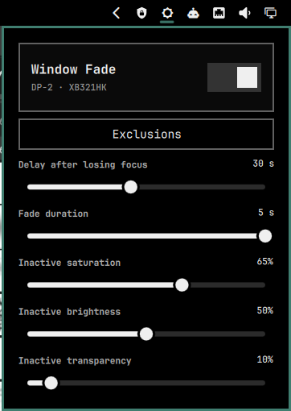

# Window Fade for OLED

Help reduce OLED burn-in risk by dimming bright, static content in unfocused
windows. Window Fade for Omarchy lets you set brightness, saturation, and
transparency per display and exclude individual windows or whole apps.

At the **50% brightness** setting, pure white in **SDR sRGB** falls to about
**21% of its original luminance** before blending. The shader halves the encoded
RGB values, and the sRGB transfer curve maps that midpoint to about 0.214 in
linear light. Actual screen luminance depends on the display and its settings.
[W3C sRGB specification](https://www.w3.org/TR/css-color/#predefined-sRGB)

Lowering the brightness of static content can reduce burn-in risk. In RTINGS’
accelerated OLED test, the display showing the same content at maximum
brightness developed more severe burn-in than the display set to 200 nits.
[RTINGS real-life OLED burn-in test](https://www.rtings.com/tv/learn/real-life-oled-burn-in-test)



## Requirements

- Omarchy Quattro with **Hyprland 0.57.2**, commit
  `11cbc6c577b84ffb1edf4df3fc5b6128c3ae6947`. Check with `hyprctl version`.
- Build dependencies on Omarchy/Arch include `base-devel`, `hyprland` with its
  matching headers, `lua` (5.5), and `libglvnd`.
- The runtime uses Quickshell, `hyprctl`, Bash, jq, and standard Linux command-line
  utilities, including `flock` from util-linux.

Window Fade loads a native plugin into Hyprland's compositor process. The
Hyprland version check is exact because internal compositor interfaces can
change between builds. Check compatibility after updating Hyprland.

## Install

Add the shell plugin and leave it disabled when prompted.

```sh
omarchy plugin add https://github.com/paulgrove/omarchy-window-fade.git
```

Build the engine from the source included in the checkout, then enable the
widget. The build runs locally and requires no network access.

```sh
plugin_dir="$HOME/.config/omarchy/plugins/pgrove.window-fade"
bash "$plugin_dir/build-engine.sh"
omarchy plugin enable pgrove.window-fade --section right
```

Window Fade uses its own build of HyprWindowShade. If you already use another
build of HyprWindowShade, unload that build before enabling Window Fade.

## Use

Click the Window Fade icon on the display you want to configure. Right-click
the icon to toggle fading on that display.

- **Delay** ranges from 0 seconds to 5 minutes. A change takes effect the next
  time a window loses focus.
- **Fade duration** ranges from 0 to 5 seconds. Focus restores the window's
  usual colors and opacity immediately.
- **Saturation and brightness** range from 0 to 100%. Zero saturation gives
  grayscale. Zero brightness turns the window content black.
- **Transparency** ranges from 0% extra transparency to 100% see-through.
- **Exclusions → Windows** lists individual windows on the display's current
  workspace. The exclusion lasts until that window closes.
- **Exclusions → Applications** lists apps across that display's workspaces.
  An exclusion also applies to windows opened later by the app.

The defaults are a one-second delay, a two-second fade, 60% saturation,
75% brightness, and 0% extra transparency. Fullscreen and Steam Proton
windows are excluded. Brightness scales the window's RGB values.

Choose **Wallpaper** in the same panel to adjust brightness and saturation on
that display. This works with Omarchy's still wallpaper and OWE's image and
video wallpaper layers. Both controls default to 100%. Zero brightness is
black and zero saturation is grayscale. Wallpaper settings also apply when
window fading is off.

Profiles are saved by display connector in
`${XDG_CONFIG_HOME:-$HOME/.config}/omarchy/window-fade-profiles.json` and restored
when displays reconnect. Run `omarchy-shell windowfade status` to see the
applied profiles.

If upgrading from an earlier build, rebuild the engine with `build-engine.sh`
and restart Hyprland to load the new engine.

## Remove

Disable the widget and unload the engine before removing the checkout.

```sh
plugin_dir="$HOME/.config/omarchy/plugins/pgrove.window-fade"
omarchy plugin disable pgrove.window-fade
bash "$plugin_dir/extension/sync.sh" --stop
omarchy plugin remove pgrove.window-fade
```

The profiles file is kept for a later reinstall. You can delete it separately
to reset all Window Fade settings.

## Source and license

Window Fade is [MIT licensed](LICENSE). The engine in [`engine/`](engine)
is based on [ManofJELLO/HyprWindowShade at
`17ff70e`](https://github.com/ManofJELLO/HyprWindowShade/tree/17ff70ec67247b9d76dbcc721af42e20a363d5d4)
and retains its [upstream MIT license](engine/LICENSE). Window Fade adds
delayed focus-loss transitions and native window opacity to that engine.
The Omarchy shell integration writes shaders to the user's runtime directory
and applies window rules through `hyprctl`.
